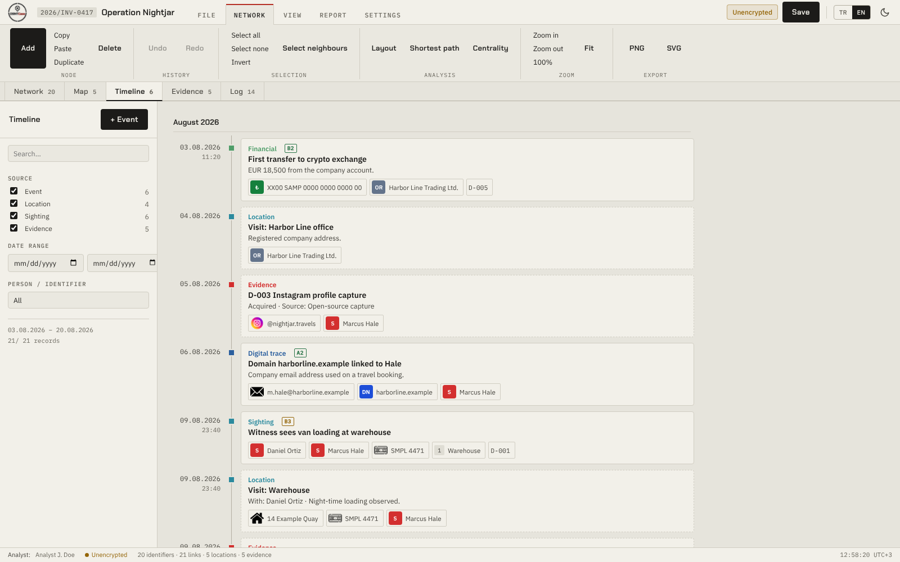
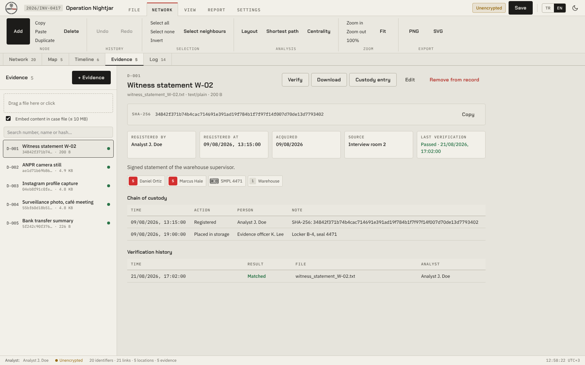

# OSINT Case

<p align="center">
  
</p>

<p align="center">
  A local investigation workspace: profile subjects, map links, build a timeline, keep evidence, export a report.<br>
  Turkish and English. No server, no telemetry.
</p>

## Install

```bash
pipx install osintcase        # or: pip install osintcase
osintcase                     # opens the app in its own window
osintcase --web               # opens it in your browser
```

From source (Node.js 18+):

```bash
npm install
npm run dev
```

## What it does

**Link network.** Confirmed, probable and doubtful links, shortest path, centrality, PNG/SVG export.


**Subject profiles.** 50+ identifier types with reliability grading.


**One timeline.** Events, visits, sightings and exhibits in a single view.



**Evidence vault.** Files with source, date and audit log.



**Reports.** PDF or single-file HTML, with optional redaction and watermark.


Locations on OpenStreetMap or Google Maps, light and dark themes.

## Sample cases

Three fictional cases are listed on the home screen and in [`example/`](example).

## Licence

[GPL-3.0](LICENSE)
