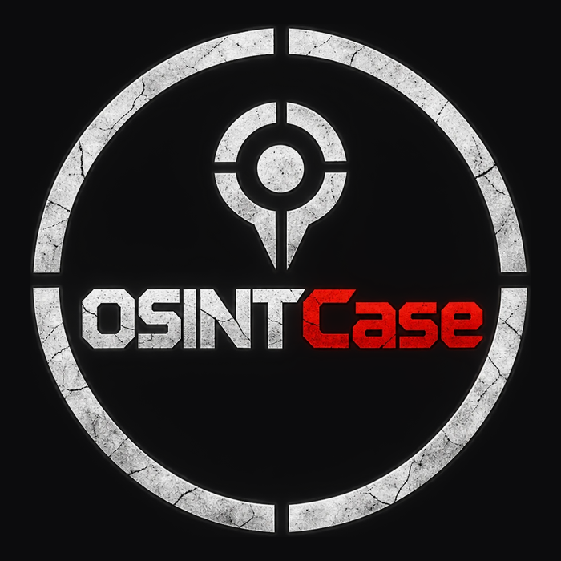
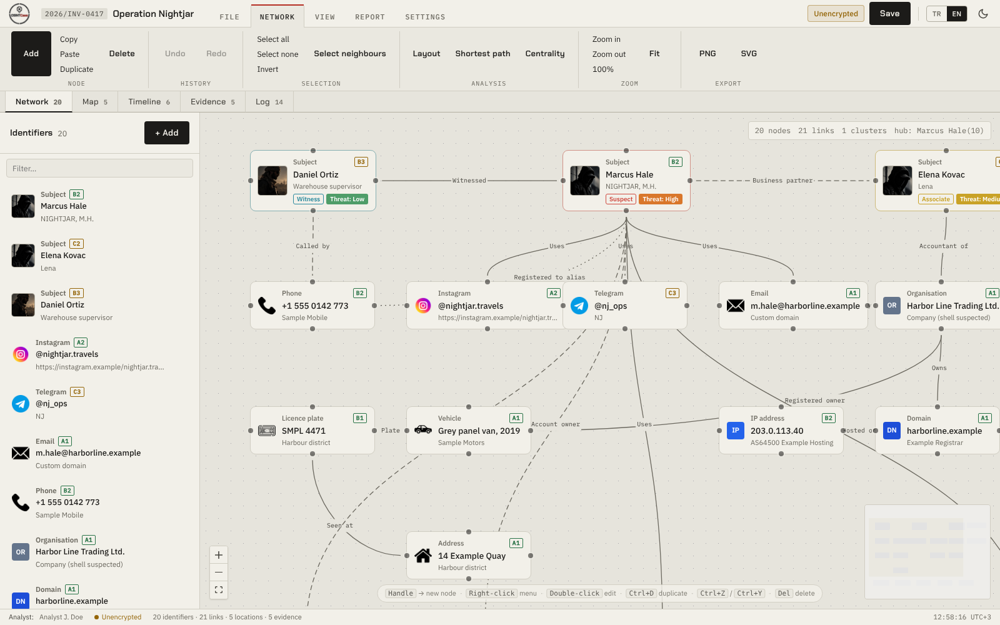
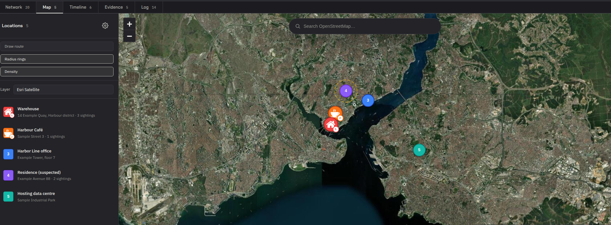
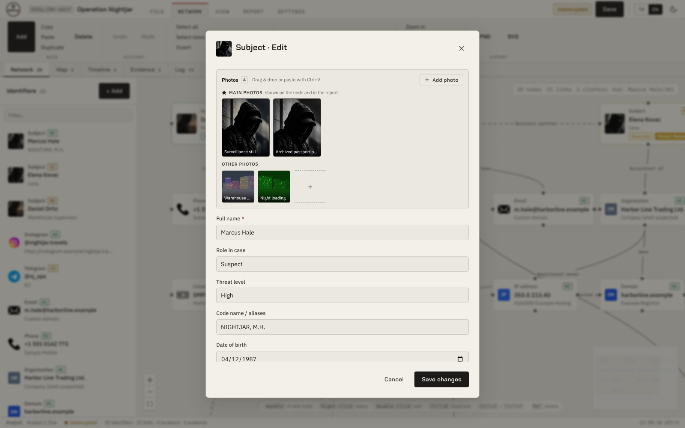
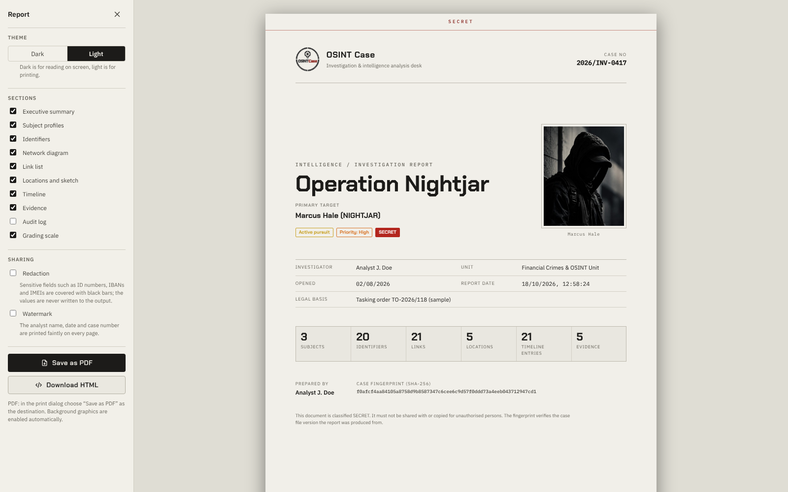
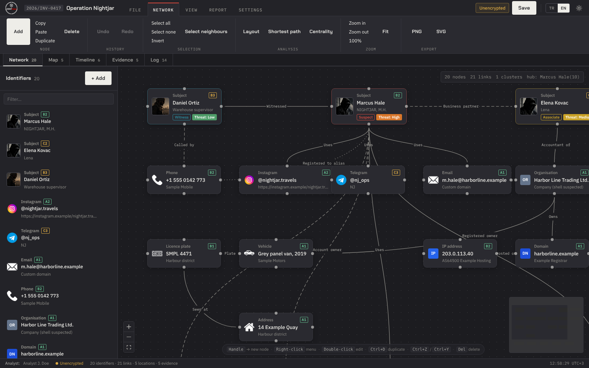
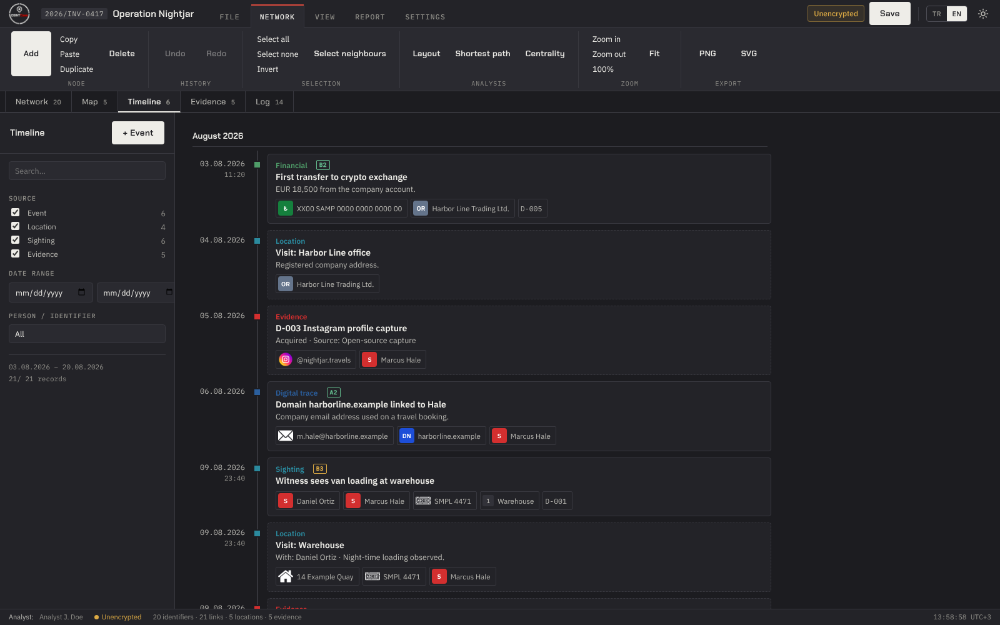
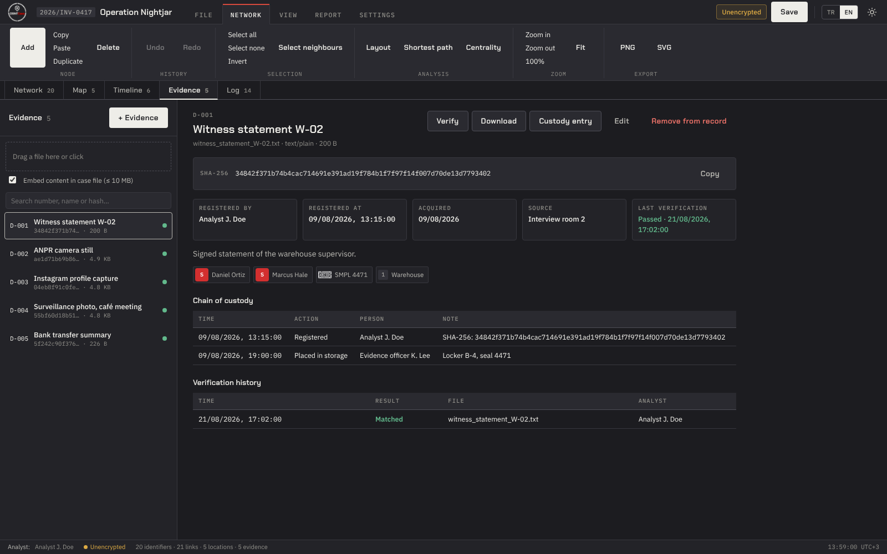
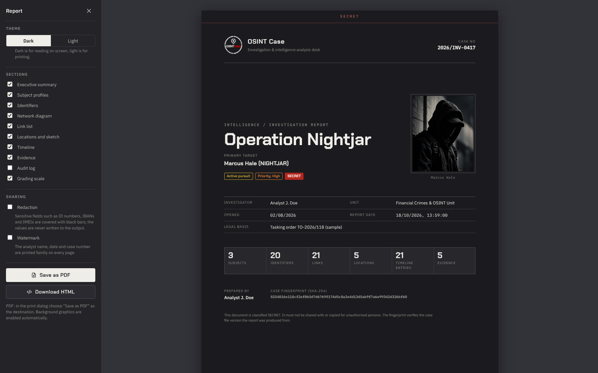

# OSINT Case

<p align="center">
  
</p>

<p align="center">
  A local investigation workspace: profile subjects, map links, build a timeline, keep evidence, export a report.<br>
  No server, no telemetry.
</p>

## Install

```bash
pipx install osintcase        # or: pip install osintcase
osintcase                     # opens the app in its own window
osintcase --web               # opens it in your browser
```

From source (Node.js 18+):

```bash
npm install
npm run dev
```

## What it does

Link network with confirmed, probable and doubtful links, shortest path and centrality. Subject
profiles with 50+ identifier types. Locations on a map. One timeline. Evidence vault with audit log.
Reports as PDF or single-file HTML.

### Light

| Link network | Map |
|---|---|
|  |  |

| Subject profile | Report |
|---|---|
|  |  |

### Dark

| Link network | Timeline |
|---|---|
|  |  |

| Evidence | Report |
|---|---|
|  |  |

## Example reports

Generated from the sample case *Operation Nightjar*:

- [Dark report (PDF)](example/example-reports/en/report-dark.pdf)
- [Light report, redacted and watermarked (PDF)](example/example-reports/en/report-light-redacted-watermarked.pdf)

## Sample cases

Three fictional cases are listed on the home screen and in [`example/`](example).

## Licence

[GPL-3.0](LICENSE)
