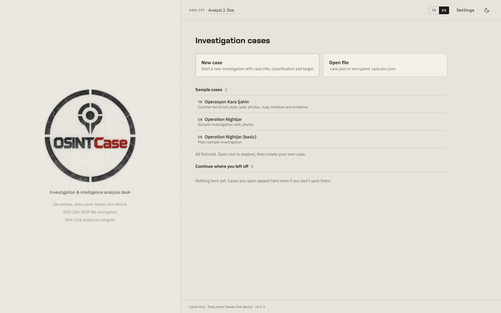

# OSINT Case

<p align="center">
  
</p>

<p align="center">
  A local investigation workspace for profiling subjects, taking notes, mapping links and writing up the case.<br>
</p>

OSINT Case does **not** run tools, query platforms or scrape anything. It is where findings you
collected elsewhere are organised, graded, linked and turned into a report.


## Install

```bash
pipx install osintcase        # or: pip install osintcase
osintcase                     # opens the app in its own window
osintcase --web               # opens it in your browser instead
```

With `pip install` (user or system) the application menu entry and logo icon are installed right away. With `pipx` they are added on first start
(`--install-shortcut` / `--uninstall-shortcut` do it by hand). To remove everything, including the menu entry, run `osintcase --uninstall`. The local server listens on
`127.0.0.1` only. On Debian/Ubuntu the window may need `sudo apt install libxcb-cursor0`;
if no window can be opened it falls back to the browser.

From source (Node.js 18+):

```bash
npm install
npm run dev          # http://localhost:5173
sh tools/build_pypi.sh   # builds the Python package into pydist/
```

Docker: `docker compose up --build`, then open `http://localhost:5173`.

## Features

- Case management with classification levels and priorities
- 50+ identifier types: people, acquaintances, employment, education, 25+ platforms, breach records and more
- Link network with confirmed / probable / doubtful links, shortest path, centrality, PNG and SVG export
- Location mapping on OpenStreetMap (no key) or Google Maps
- One timeline merging events, visits, sightings and exhibits
- Evidence vault, audit log, optional encryption
- Reports: cover, summary, profiles, network, locations, timeline, exhibits, grading key

## Sample cases

The home screen lists three fictional cases. Open one to explore; the files are also in [`example/`](example).

| Case | Language | Notes |
|---|---|---|
| `operasyon-kara-sahin.case.json` | TR | Counter-terrorism style case with photos, map, timeline, evidence |
| `operation-nightjar-photos.case.json` | EN | Smuggling and money-laundering investigation with photos |
| `operation-nightjar.case.json` | EN | The same case without photos |

Exported reports are in [`example/example-reports`](example/example-reports) (dark PDF, light redacted and
watermarked PDF, single-file HTML, in `en/` and `tr/`). Photos are synthetic, not real people.
`python3 tools/apply-sample-photos.py` re-applies them.

## Screenshots

| Home | Subject profile |
|---|---|
|  |  |

| Timeline | Evidence |
|---|---|
|  |  |

| Report | Dark theme |
|---|---|
|  |  |

## Privacy

Everything runs on your machine. Case data and evidence stay on the local device; storing case
files is up to you. Use it only for authorised investigations and process personal data only with a
lawful basis.

## Licence

[GPL-3.0](LICENSE)
